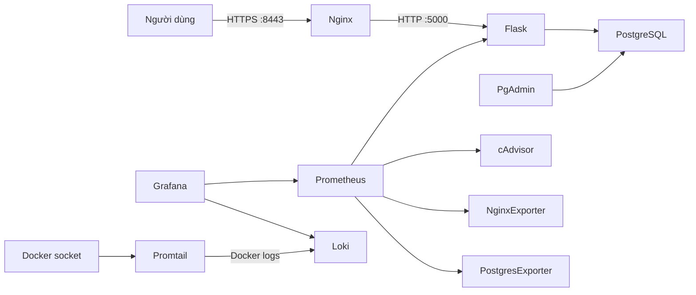

# DTC245200911 — Expense Tracker

Đề 38: hệ thống quản lý chi tiêu cá nhân/gia đình bằng Flask, PostgreSQL, Nginx, Prometheus, Grafana và Loki. Toàn bộ dịch vụ chạy bằng Docker Compose; dữ liệu giao dịch gồm danh mục, khoản thu/chi, ghi chú và ngày tạo.

## Kiến trúc



Ba mạng được tách theo vai trò: `net-web` cho giao diện, `net-db` là mạng nội bộ cho PostgreSQL, `net-mon` cho giám sát/log. Ứng dụng và Nginx không publish cổng ghi/đọc nội bộ của chúng ra host.

## Yêu cầu

- Docker Desktop với Linux containers và Docker Compose v2.
- Git; OpenSSL cài trên máy hoặc Docker để chạy OpenSSL trong Alpine.
- Các cổng host 8080, 8443, 5050, 3000 và 9090 chưa được ứng dụng khác sử dụng.
- Git `user.name` và `user.email` đã cấu hình nếu muốn tạo commit.

## Khởi chạy

```powershell
git clone <URL-cua-repo> DTC245200911-expense-tracker
Set-Location DTC245200911-expense-tracker
Copy-Item .env.example .env
```

Sửa các mật khẩu và `SECRET_KEY` trong `.env` thành giá trị riêng, dài, chỉ gồm chữ cái, chữ số và `_`. Không commit `.env`.

Tạo chứng chỉ tự ký RSA 2048-bit, hạn 365 ngày, SAN cho `localhost` và `127.0.0.1`. Trên Windows PowerShell (khi chưa cài OpenSSL):

```powershell
New-Item -ItemType Directory -Path nginx/certs -Force | Out-Null
$certDir = (Resolve-Path nginx/certs).Path
docker run --rm --mount "type=bind,source=$certDir,target=/certs" alpine:3.20 sh -c "apk add --no-cache openssl >/dev/null && openssl req -x509 -nodes -days 365 -newkey rsa:2048 -keyout /certs/server.key -out /certs/server.crt -subj '/CN=localhost' -addext 'subjectAltName=DNS:localhost,IP:127.0.0.1' && chmod 644 /certs/server.key"
```

Trên Linux/macOS/WSL, có thể dùng lệnh tương tự với `-v "$PWD/nginx/certs:/certs"` thay cho `--mount`. Chứng chỉ và private key tự ký chỉ dành cho môi trường lab; trình duyệt sẽ cảnh báo và cần chấp nhận ngoại lệ.

```powershell
docker compose config
docker compose up -d --build
docker compose ps
```

## Đăng ký và đăng nhập

Mở trang ứng dụng, chọn **Đăng ký**, tạo tên đăng nhập (3–50 ký tự gồm chữ/số, `_`, `.` hoặc `-`) và mật khẩu 10–128 ký tự. Sau khi đăng ký, bạn được đăng nhập tự động; những lần sau dùng biểu mẫu **Đăng nhập**. Mỗi người chỉ xem, thêm và xóa giao dịch của tài khoản mình. Mật khẩu lưu dưới dạng hash, phiên đăng nhập dùng cookie Secure/HttpOnly/SameSite và yêu cầu HTTPS.

`SECRET_KEY` trong `.env` dùng để ký cookie phiên. Hãy thay giá trị mẫu bằng một chuỗi ngẫu nhiên riêng và giữ bí mật; thay key sẽ đăng xuất tất cả phiên hiện có.

Trang **Chi tiêu theo ngày** (`/calendar`) hiển thị lịch theo tháng/năm, biểu đồ cột so sánh tổng thu/chi trong kỳ, giao dịch của ngày được chọn, tổng chi và tổng thu từng tháng, cùng mức tăng/giảm so với tháng liền trước. Biểu đồ tháng hiện tại tính từ ngày đầu tháng đến hôm nay; các tháng khác tính trọn tháng. Có thể chọn ngày trên biểu mẫu khi thêm giao dịch; ngày mặc định là hôm nay. Số tiền tối thiểu là **1.000 ₫**. Khi chọn **Khác (Chi)**, cần ghi mô tả khoản chi; ứng dụng từ chối ghi chú để trống hoặc chỉ có khoảng trắng.

Khi nâng cấp một bản cài đặt đã có volume PostgreSQL, chạy migration **một lần** trước khi rebuild app. Migration giữ giao dịch cũ, thêm danh mục chi **Khác** an toàn khi chạy lặp lại; tài khoản đăng ký đầu tiên sẽ nhận các giao dịch chưa có chủ sở hữu:

```powershell
$dbUser = (Select-String '^DB_USER=' .env).Line.Split('=', 2)[1]
$dbName = (Select-String '^DB_NAME=' .env).Line.Split('=', 2)[1]
$appUser = (Select-String '^APP_DB_USER=' .env).Line.Split('=', 2)[1]
$dbContainer = docker compose ps -q db
docker cp db/02-auth-migration.sql "${dbContainer}:/tmp/02-auth-migration.sql"
docker compose exec -T db psql -v ON_ERROR_STOP=1 -U $dbUser -d $dbName --set app_user=$appUser -f /tmp/02-auth-migration.sql
docker compose up -d --build
```

Với triển khai mới dùng volume mới, migration thủ công không cần thiết; `db/01-init.sh` tạo schema đăng nhập tự động.

## URL và tài khoản

| Dịch vụ | URL |
|---|---|
| Expense Tracker | https://localhost:8443 |
| Chi tiêu theo ngày | https://localhost:8443/calendar |
| Chuyển hướng HTTP | http://localhost:8080 |
| pgAdmin | http://localhost:5050 |
| Grafana | http://localhost:3000 |
| Prometheus | http://localhost:9090 |

Các cổng quản trị chỉ bind vào `127.0.0.1`. Tài khoản ứng dụng được tạo ở trang **Đăng ký**; tài khoản pgAdmin/Grafana được cấu hình trong `.env`. Không dùng chung tài khoản quản trị PostgreSQL cho ứng dụng. pgAdmin đăng nhập PostgreSQL bằng `DB_USER` và `DB_PASSWORD`; ứng dụng dùng role ít quyền `APP_DB_USER`.

Trong pgAdmin, đăng ký server với **Host** `db`, **Port** `5432`, **Maintenance database** `DB_NAME`, **Username** `DB_USER`, **Password** `DB_PASSWORD`. Host `db` chỉ phân giải bên trong mạng Docker.

> **Cổng 80/443:** máy phát triển này đã có container `sochi-nginx-1` chiếm cổng 80/443. Để không dừng dịch vụ khác, Compose dùng 8080/8443 và HTTP chuyển hướng sang HTTPS 8443. Nếu 80/443 đã trống trên máy khác, đổi mapping Nginx thành `80:8080` và `443:8443`, rồi bỏ `:8443` trong `return 301` của `nginx/default.conf`.

## Giám sát và log

Dashboard **Expense Tracker Overview** được provision tự động trong Grafana, gồm tốc độ request, giao dịch mới, CPU container, kết nối Nginx, trạng thái PostgreSQL và log theo service. Datasource Prometheus và Loki cũng được provision từ file cấu hình.

Mở Grafana → **Explore** → datasource Loki để chạy các truy vấn trong [docs/logql-queries.md](./docs/logql-queries.md). Có thể nhập thêm dashboard cộng đồng theo ID:

- `14282` — cAdvisor
- `12708` — NGINX
- `9628` — PostgreSQL

## Hardening

Các kiểm tra và kết quả thực tế được ghi trong [docs/hardening.md](./docs/hardening.md). Biện pháp chính: app chạy UID 10001; Nginx dùng image unprivileged; PostgreSQL chỉ nằm trên mạng internal; cổng quản trị chỉ bind loopback; app/Nginx dùng root filesystem read-only, `tmpfs /tmp`, bỏ capabilities và bật `no-new-privileges`; role app chỉ có quyền CRUD cần thiết.

## Dừng và xóa dữ liệu

```powershell
docker compose down
```

Lệnh sau xóa cả volume PostgreSQL, pgAdmin, Prometheus, Grafana và Loki; chỉ chạy khi đã chấp nhận mất dữ liệu:

```powershell
docker compose down -v
```

## Xử lý lỗi thường gặp

- **Cổng đã được sử dụng:** xem `docker compose ps` và `Get-NetTCPConnection -State Listen`; không dừng container/dịch vụ khác nếu chưa xác định chủ sở hữu. Đổi host port và cập nhật URL/redirect tương ứng.
- **App chưa healthy:** chạy `docker compose ps`, sau đó `docker compose logs --tail=100 app db`; kiểm tra `.env`, trạng thái PostgreSQL và mạng `net-db`.
- **Bảng chưa có:** `db/01-init.sh` chỉ chạy khi volume dữ liệu mới được khởi tạo. Với dữ liệu lab có thể dùng `docker compose down -v` rồi `docker compose up -d --build`; lệnh này xóa toàn bộ dữ liệu.
- **Trình duyệt cảnh báo HTTPS:** chứng chỉ tự ký là bình thường trong lab; không dùng chứng chỉ này cho production.
- **cAdvisor không có nhãn `name`:** Docker Desktop/WSL2 có thể chỉ xuất các nhãn cgroup như `id`; dashboard dùng `id` để vẫn hiển thị CPU. cAdvisor cũng có thể ghi cảnh báo về container cũ không còn mount layer.
- **Promtail cần quyền Docker:** socket được mount `:ro`, nhưng đây không phải proxy chỉ đọc ở cấp Docker API. Chỉ chạy stack trên máy tin cậy; Promtail cần socket để phát hiện container và lấy log.
- **Git không cho commit:** kiểm tra `git config user.name` và `git config user.email`. Repo không tự thêm remote và không push.
